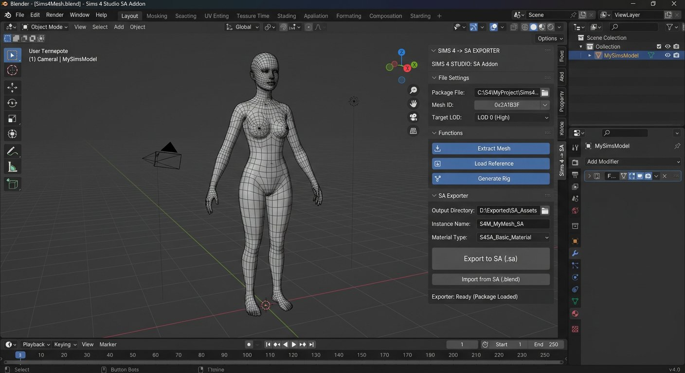

# The Sims 4 → GTA San Andreas — Conversor DFF para Blender

<p align="center">
  
</p>

<p align="center">
  <a href="https://github.com/Viniciaao/Sims4_para_GTA_SA_Blender/releases"></a>
  <a href="LICENSE"></a>
  
  
  
</p>

<p align="center">
  <b>Transforme qualquer personagem The Sims 4 (.dae) em um ped jogável de GTA San Andreas (.dff) — direto no Blender, em um clique.</b><br>
  Skeleton HAnim padrão de 32 ossos • Pesos remapeados • UVs preservados • Validação completa
</p>

<p align="center">
  <a href="#-instalação-em-2-minutos">Instalação</a> •
  <a href="#-como-converter">Como Converter</a> •
  <a href="#-demonstração">Demonstração</a> •
  <a href="#-mapeamento-de-skeleton">Skeleton</a> •
  <a href="#-ajuste-vertical">Ajuste Vertical</a> •
  <a href="docs/README.md">Documentação Completa →</a>
</p>

---

## ✨ O que este addon faz?

Este addon para Blender automatiza **todo o pipeline** de conversão de um personagem do The Sims 4 para o formato de ped do GTA San Andreas:

```
.dae (COLLADA Sims 4)  →  [ Blender + DragonFF ]  →  .dff (GTA SA PC) + .json (relatório)
     185 ossos Sims 4         retarget + validação         32 ossos HAnim SA
```

1. **Importa** o `.dae` com o importer COLLADA nativo do Blender 4.2–4.5
2. **Normaliza** todas as meshes para o espaço local do armature (corrige rotação/offset)
3. **Junta** múltiplas meshes skinned em **uma única Geometry/Atomic** preservando UVs e materiais
4. **Exporta** um DFF intermediário temporário via DragonFF
5. **Reconstrói** o skeleton/skin SA de 32 ossos com IDs HAnim corretos e pesos normalizados
6. **Valida** binds, pesos, topologia, UVs e alinhamento mesh/skeleton antes de gravar
7. **Gera** relatório `.relatorio.json` com hashes, contagens e avisos

> **Você não precisa exportar DFF manualmente.** O intermediário fica em pasta temporária e é removido automaticamente. Seu `.dae` original nunca é alterado.

### Por que usar este conversor?

| Recurso | Detalhe |
|---|---|
| **1 clique** | Seleciona DAE → escolhe saída → Converter |
| **Skeleton correto** | 32 ossos HAnim padrão SA (compatível com animações do jogo) |
| **UVs intactos** | Junta meshes sem perder UV secundário; materiais viram slots |
| **Validação rigorosa** | Recusa conversões ambíguas em vez de gerar DFF quebrado |
| **Relatório completo** | JSON com contagens, mapeamento, hashes SHA256 e avisos |
| **Ajuste fino** | Slider de altura `−1.5` a `+1.5` para corrigir flutuar/afundar no jogo |
| **Open Source** | GPL-3.0 — use, modifique e distribua |

---

## 🆕 Novidades da v1.0.8

> **Correção crítica de bind-space** — resolve travamentos em modelos como `AbbyS.dae`

Anteriormente o addon calculava `bone_world = atomic_world × inverse(inverse_bind)` usando o frame do `Atomic` (`b__ROOT__`) como origem, enquanto as matrizes `inverse_bind` estavam no espaço do frame `rig` (objeto/armature). Isso contava a transformação do Root **duas vezes**, gerando erro aparente de `0.021` (limite `0.002`) mesmo com skeleton válido.

**v1.0.8** testa **todos os frames candidatos** contra as `inverse_bind` e escolhe o único frame-base que reconcilia todos os binds abaixo do limite. Para `AbbyS.dae` o erro caiu de `0.0211164` → `0.000000485` ✅

| Versão | Destaque |
|---|---|
| **v1.0.8** | Auto-detecção do frame-base do Skin; corrige AbbyS e DAEs com `Z_UP` |
| **v1.0.7** | Junta meshes em 1 Geometry/Atomic; valida contagem (antes aceitava 2) |
| **v1.0.6** | Lembrete no painel: `Ajuste recomendado (HFYSTB): -1.060` |
| **v1.0.5** | Slider vertical `−1.5` a `+1.5`; bake mesh→armature; preserva UVs |
| **v1.0.2** | Atomics separadas (corrigido em v1.0.7); valida orientação |

Veja o [CHANGELOG completo](CHANGELOG.md) com todos os detalhes técnicos.

---

## 📋 Requisitos

| Item | Versão | Onde obter |
|---|---|---|
| **Blender** | **4.2 – 4.5 LTS** | [blender.org/download](https://www.blender.org/download/) |
| **DragonFF** | **1.1.0** | [extensions.blender.org/add-ons/dragonff](https://extensions.blender.org/add-ons/dragonff/) |
| **DAE** | COLLADA com 1 armature + meshes skinned + vertex groups | Exportado do Sims 4 Studio / Blender |

> ⚠️ **Blender 5.0+ NÃO serve** — o importer COLLADA foi removido. Use 4.2 ou 4.5 LTS.
> 
> ⚠️ **DragonFF é obrigatório** e não está incluído no ZIP. Instale antes.

**DAE compatível:**
- Um único armature Sims 4 (padrão adulto/CAS, nomes `b__...__`)
- Malhas com pesos (skinned) — até 4 influências por vértice
- Triângulos já triangulados

**Não converte:** `.package`, `.sim`, `.blend`, animações IFP, texturas → TXD, YDD/YFT

---

## 🚀 Instalação em 2 minutos

### 1) Instale o DragonFF 1.1.0

No Blender: `Edit → Preferences → Get Extensions` → busque **DragonFF** → `Install` → ative.

Ou baixe em: https://extensions.blender.org/add-ons/dragonff/

Verifique que aparece em `Preferences → Add-ons` como **DragonFF**.

### 2) Instale este addon

1. Baixe o ZIP da última release: [**Sims4_para_GTA_SA_Blender_Addon_v1.0.8.zip**](https://github.com/Viniciaao/Sims4_para_GTA_SA_Blender/releases/latest)
2. No Blender: `Edit → Preferences → Add-ons → Install from Disk…` (ou `Get Extensions → Install from Disk…`)
3. Selecione o ZIP → clique em **Install**
4. Ative **The Sims 4 -> GTA SA DFF Converter** (marque a caixinha)
5. No Viewport 3D pressione **N** → aba **Sims 4 -> SA** aparecerá

<p align="center">
  
  <br><em>Painel Sims 4 → SA no Blender (N → Sims 4 -> SA)</em>
</p>

Pronto! Veja também o [guia passo a passo com imagens](docs/instalacao.md).

---

## 🎮 Como Converter

### Passo a passo

1. **Abra o painel:** Viewport 3D → pressione **N** → aba **Sims 4 -> SA**
2. **DAE de entrada:** clique na pasta e selecione seu `.dae` (ex: `MeuPersonagem.dae`)
3. **DFF de saída:** escolha pasta/nome. Se deixar vazio, cria `MeuPersonagem_SA.dff` ao lado do DAE
4. **Opções:**
   - ✅ **Ajustar membros para pose-base SA** — deixe marcado na primeira tentativa
   - **Ajuste vertical do ped:** `0.000` para testes iniciais (veja [Ajuste Vertical](#-ajuste-vertical))
   - ☐ **Permitir sobrescrever a saída** — só marque se quer substituir DFF existente
   - ✅ **Importar DFF final na cena** — útil para inspecionar o resultado
5. **Clique em `Converter DAE -> DFF SA`**
6. Aguarde a mensagem de sucesso — o DFF e o `.relatorio.json` estarão na pasta escolhida


### Arquivos gerados

```
MeuPersonagem_SA.dff            ← modelo para o jogo (coloque em ModLoader)
MeuPersonagem_SA.relatorio.json  ← relatório técnico da conversão
```

Se a validação falhar, um `*_intermediario_debug.dff` é salvo para diagnóstico — **não use no jogo**, é apenas para reportar bug.

### Próximos passos no GTA SA

1. O DFF contém **geometria + skeleton** — você ainda precisa de um **TXD** com texturas
2. Extraia as imagens do DAE (ex: `*_diffuse.png`) e crie o TXD com **TXD Workshop** ou **Magic TXD**
3. Instale via **ModLoader**: `GTA SA/ModLoader/MeuPed/meu_ped.dff` + `meu_ped.txd` + `peds.ide`
4. Teste no jogo: **parado, andar/correr, mira, mãos, joelhos, pés no chão**

> 💡 **Dica:** Teste primeiro sem texturas (DFF branco) para confirmar que o skeleton não está quebrado. Depois adicione o TXD.

---

## 🦴 Mapeamento de Skeleton

O Sims 4 usa **185 ossos** — o GTA SA usa **32**. Este addon faz um **retarget many-to-one**:

| Sims 4 (origem) | → | GTA SA (destino) | ID HAnim |
|---|---|---|---|
| `b__ROOT__`, `b__ROOT_bind__` | → | Root | 0 |
| `b__Pelvis__` | → | Pelvis | 1 |
| `b__Spine0__`, `b__Spine1__` | → | Spine | 2 |
| `b__Spine2__`, `b__Spine3__` | → | Spine1 | 3 |
| `b__Neck__` | → | Neck | 4 |
| `b__Head__` | → | Head | 5 |
| `b__L/R_OutBrow__`, `b__L/R_InBrow__` | → | Brow | 6 / 7 |
| `b__Jaw__`, `b__LoLip__`, `b__UpLip__` | → | Jaw | 8 |
| `b__R_Clavicle__` | → | R Clavicle | 21 |
| `b__R_UpperArm__` (+ twist) | → | R UpperArm | 22 |
| ... | → | ... | ... |
| `b__L_Thigh__` (+ twist) | → | L Thigh | 41 |
| `b__CAS_L/R_Breast__` | → | Breast | 301 / 302 |
| `b__Belly__` | → | Belly | 201 |

→ Mapa completo em [`sims4_bone_map.json`](sims4_sa_converter/sims4_bone_map.json) — **107 entradas** cobrindo todos os ossos do teste `AbbyS.dae`

**O que acontece com ossos sem equivalente?**
- **Dedos extras** (mindinho, anelar, médio): agrupados nos dedos indicador/mindinho SA
- **Faciais** (bochechas, pálpebras, olhos): agrupados em Head/Jaw/Brow
- **Twists** (ombro, coxa, antebraço): agrupados no osso principal
- **Slots** (brincos, óculos, chapéu): agrupados no ancestral mais próximo

> ⚠️ Isso é **perda esperada de independência** — não é bug. O rig SA tem menos canais. Animações de dedos e expressões faciais não terão 1:1.

**DAE com nomes diferentes?** Indique seu **Mapa JSON customizado** no painel. Ele substitui totalmente o mapa incluído.

**Referência customizada:** Você pode usar um DFF de ped padrão SA (32 ossos, PC, não CJ/animal/cutscene) como referência, no campo **Ped SA de referência**. Vazio usa o preset `sa_preset.json` incluído (conferido com `ballas1`).

---

## 📐 Ajuste Vertical

Modelos diferentes ficam em alturas diferentes no GTA SA. Use o campo **Ajuste vertical do ped** (`−1.5` a `+1.5`):

| Valor | Efeito | Quando usar |
|---|---|---|
| `0.000` | Sem ajuste (padrão) | Primeira tentativa com modelo novo |
| **−1.060** | Abaixa 1.06 unidades | **HFYSTB** — ponto validado pela comunidade |
| `−0.60` a `−0.95` | Abaixa moderado | Se `−1.060` afundar |
| `−0.25` | Abaixa leve | Se ainda flutuar pouco |
| `+0.20` | Levanta | Se afundar no chão |

**Como calibrar um modelo novo:**
1. Comece em `0.000` → teste no jogo
2. Se **flutuar** → tente `−0.50` → ainda flutua? → `−1.00`
3. Se **afundar** → volte metade do caminho (ex: `−0.75`)
4. Ajuste em passos de `0.10` até o contato dos pés ficar perfeito
5. Anote o valor — cada modelo tem seu ponto ideal

O valor usado fica registrado no `.relatorio.json` (`ground_offset`).

---

## 📊 Relatório JSON

Cada conversão gera um `.relatorio.json` com tudo que você precisa para auditar:

```json
{
  "tool_version": "1.0.8",
  "source_bones": 185,
  "target_bones": 32,
  "vertices": 44368,
  "triangles": 68547,
  "mapping": [ { "source_name": "b__Spine0__", "target_id": 2 } ],
  "maximum_bind_frame_error": 4.8e-07,
  "validation": { "passed": true },
  "warnings": ["Retarget many-to-one: dedos perdem canais..."],
  "ground_offset": -1.06,
  "output_sha256": "395b0ac6..."
}
```

Use para comparar conversões e reportar bugs (anexe o JSON na issue).

---

## 🗂️ Estrutura do Projeto

```
Sims4_para_GTA_SA_Blender/
├── sims4_sa_converter/          ← Addon (instale este ZIP)
│   ├── __init__.py              ← Interface Blender + pipeline DragonFF
│   ├── core.py                  ← Núcleo: leitura/validação/retarget DFF (puro Python)
│   ├── sa_preset.json           ← Preset skeleton SA 32 ossos (conferido com ballas1)
│   ├── sims4_bone_map.json      ← Mapa 107 ossos Sims4 → SA
│   └── README.md                ← Doc técnica do addon
├── docs/                        ← Documentação completa
│   ├── instalacao.md
│   ├── uso.md
│   ├── mapeamento.md
│   └── troubleshooting.md
├── assets/images/               ← Imagens do README e docs
├── examples/                    ← Exemplos de uso e relatórios
├── releases/                    ← ZIPs das versões (histórico)
├── CHANGELOG.md
├── CONTRIBUTING.md
├── LICENSE (GPL-3.0)
└── README.md (este arquivo)
```

---

## ❓ Problemas Comuns

| Erro no Blender | Causa | Solução |
|---|---|---|
| `Importador COLLADA não encontrado` | Blender 5.0+ ou importer desativado | Use **Blender 4.2 ou 4.5 LTS** |
| `DragonFF não está ativo` | DragonFF não instalado | Instale DragonFF 1.1.0 antes |
| `Esperado um único armature` | DAE com múltiplos rigs ou sem rig | Use DAE com 1 armature adulto/CAS |
| `não tem vertex groups que coincidam` | Mesh não rigada | Verifique pesos no Sims 4 Studio |
| `Frame contém NaN/infinito` | DAE corrompido | Reexporte o DAE |
| DFF branco no jogo | Sem TXD | Crie TXD com as texturas do DAE |
| Personagem flutua/afunda | Altura diferente | Ajuste **Ajuste vertical** (ex: `−1.060` para HFYSTB) |
| Mãos/braços tortos | Pose não baked | Deixe **Ajustar membros para pose-base SA** marcado |

Veja [Troubleshooting completo](docs/troubleshooting.md).

---

## 🤝 Contribuindo

Contribuições são bem-vindas! Veja [CONTRIBUTING.md](CONTRIBUTING.md).

- Reporte bugs com: versão do addon, Blender, DAE (ou `relatorio.json` + `debug.dff` se falhar)
- Sugira novos mapeamentos de ossos via PR no `sims4_bone_map.json`
- Traduções, melhorias de docs e testes são ótimos primeiros PRs

---

## 📜 Licença e Créditos

- **Código deste addon:** [GPL-3.0-or-later](LICENSE) — livre para usar, modificar e distribuir
- **DragonFF:** projeto independente, não incluído — [github.com/Parik27/DragonFF](https://github.com/Parik27/DragonFF)
- **Preset SA:** hierarquia/eixos conferidos com `ballas1` (sem malha/texturas)
- **Personagens/malhas/texturas:** continuam com seus respectivos titulares (EA/Maxis para Sims 4, Rockstar para GTA SA)

> Este projeto não é afiliado à EA, Maxis ou Rockstar Games.

---

## 🔗 Links Úteis

- [Releases (baixar ZIP)](https://github.com/Viniciaao/Sims4_para_GTA_SA_Blender/releases)
- [Documentação completa](docs/README.md)
- [Reportar bug / pedir feature](https://github.com/Viniciaao/Sims4_para_GTA_SA_Blender/issues)
- [Blender LTS](https://www.blender.org/download/lts/) • [DragonFF](https://extensions.blender.org/add-ons/dragonff/) • [TXD Workshop](https://www.gtagarage.com/mods/show.php?id=8320)

<p align="center">
  <b>Feito com ❤️ para a comunidade GTA SA modding</b><br>
  Se este addon te ajudou, deixe uma ⭐ no repositório!
</p>

---

<p align="center">
  <a href="README_EN.md">🇺🇸 English version</a>
</p>
